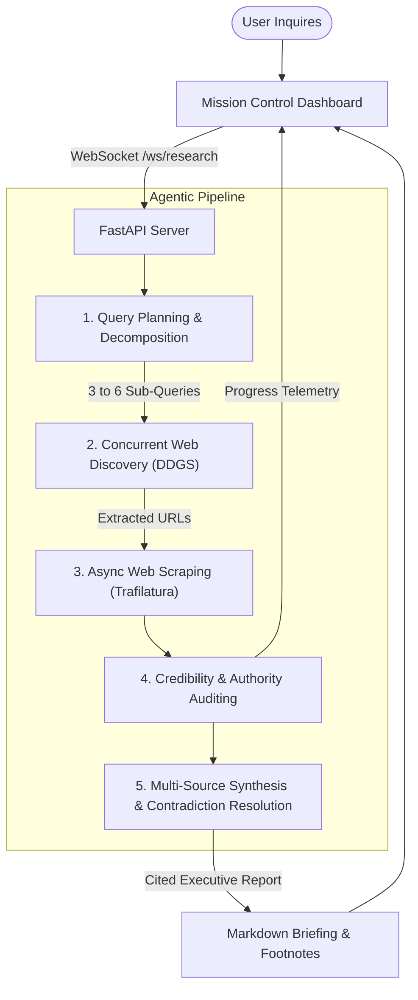

# 🧠 Cognita: Autonomous Deep Research Agent

> **Self-Directed Multi-Source Intelligence & Synthesis Engine**  
> *Inspired by OpenAI Deep Research and Perplexity AI.*

[](https://python.org)
[](https://fastapi.tiangolo.com)
[](LICENSE)
[](#-system-architecture)

---

## 🌟 Overview

**Cognita** is an open-source autonomous deep research agent. Instead of a simple single-prompt chatbot answer, Cognita executes a **multi-stage investigation pipeline**:

1. **Strategic Decomposition**: Deconstructs high-level inquiries into multi-perspective sub-queries (technical breakthroughs, economics/market, competition, risks/regulations).
2. **Autonomous Web Discovery**: Conducts live parallel web searches across search engines and academic repositories.
3. **Full-Text Ingestion & Noise Removal**: Uses high-performance extractors (`Trafilatura` & `httpx`) to isolate article bodies and discard ads, trackers, and navigation clutter.
4. **Authority & Credibility Auditing**: Evaluates domain authority (`.gov`, `.edu`, peer-reviewed journals, Tier-1 news) and scores sources from 0.0 to 1.0.
5. **Synthesis & Footnote Citations**: Compiles a structured, rigorous executive briefing with inline citations (`[1]`, `[2]`), comparative matrices, and verified references.
6. **Real-Time WebSocket Telemetry**: Streams agent thoughts, sub-queries, and crawled sources live to a futuristic mission control dashboard.

---

## 🏛️ System Architecture



---

## ✨ Core Features

- ⚡ **Zero-Config Web Search**: Free, reliable search out of the box using DuckDuckGo Search (`ddgs`) with zero API keys required.
- 🔬 **Multi-Depth Investigation**: Supports `Quick (2 tracks)`, `Deep (4 tracks)`, and `Exhaustive (6 tracks)` modes.
- 🛡️ **Source Authority Engine**: Automatically scores academic, institutional, and news domains to prioritize credible data over SEO spam.
- 🤖 **Universal Multi-LLM Support**:
  - **Google Gemini** (Gemini 2.5 Flash)
  - **OpenAI** (GPT-4o / GPT-4o-mini)
  - **Groq** (Llama-3.3-70B)
  - **Local Ollama** (Llama-3.2)
  - **Offline NLP Synthesizer** (Works 100% offline without any API keys)
- 📊 **Real-Time Telemetry Dashboard**: Dark glassmorphic interface showing live agent thoughts, pipeline breadcrumbs, parsed character counts, and dynamic source pills.
- 📑 **Export Options**: One-click Copy to Markdown, `.md` file download, and printable formatting.

---

## 🚀 Quick Start Guide

### 1. Clone the Repository
```bash
git clone https://github.com/your-username/cognita-deep-research.git
cd cognita-deep-research
```

### 2. Set Up Virtual Environment

**Windows (PowerShell):**
```powershell
python -m venv .venv
.venv\Scripts\Activate.ps1
```

**macOS / Linux:**
```bash
python3 -m venv .venv
source .venv/bin/activate
```

### 3. Install Dependencies
```bash
pip install -r requirements.txt
```

### 4. (Optional) Configure API Keys
Cognita works out of the box with the **built-in offline synthesizer**! To unlock full neural reasoning, copy `.env` and add your preferred key:
```env
# Optional: Add any of these
GEMINI_API_KEY=your_gemini_api_key_here
OPENAI_API_KEY=your_openai_api_key_here
GROQ_API_KEY=your_groq_api_key_here
```

### 5. Launch the Application
```powershell
python main.py
```
Open your browser and navigate to:
👉 **[http://127.0.0.1:8000](http://127.0.0.1:8000)**

---

## 📂 Project Structure

```
├── engine/
│   ├── __init__.py
│   ├── agent.py          # Autonomous Deep Research Agent orchestration
│   ├── llm.py            # Multi-provider LLM connector & offline synthesizer
│   ├── models.py         # Pydantic data schemas & telemetry event models
│   ├── scraper.py        # Async web scraper & credibility evaluation
│   └── search.py         # Web discovery engine (DDGS + fallback)
├── static/
│   ├── css/
│   │   └── style.css     # Modern glassmorphism styling & animations
│   └── js/
│       └── app.js        # WebSocket streaming & client-side Markdown rendering
├── templates/
│   └── index.html        # Interactive Research Command Center
├── .env                  # Environment configuration
├── .gitignore            # Git exclusion rules
├── main.py               # FastAPI server & WebSocket endpoints
├── requirements.txt      # Pinned production dependencies
└── README.md             # Comprehensive project documentation
```

---

## 🧪 Testing the Engine Directly via CLI

You can also run research directly from the Python terminal without the web UI:

```python
import asyncio
from engine.models import ResearchRequest
from engine.agent import DeepResearchAgent

async def run():
    req = ResearchRequest(query="Solid-state EV batteries in 2026", depth="quick")
    agent = DeepResearchAgent(req)
    report = await agent.execute()
    print(f"Report Generated! Words: {report.total_words}, Sources: {len(report.sources)}")
    print(report.markdown_report)

asyncio.run(run())
```

---

## 📜 License

Distributed under the **MIT License**. See `LICENSE` for details.
